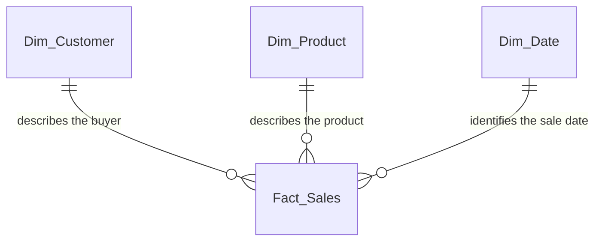

# Data Modeling for Analytics

A learning guide to relational and dimensional modeling, from defining what one row represents to building a star schema and preserving historical context.

The examples use retail orders, customers, products, and returns. Basic SQL knowledge is helpful. You can read the lessons directly on GitHub.

## Learning path

| Step | Lesson | Question you’ll learn to answer |
| --- | --- | --- |
| 1 | [Grain, Keys, and Normalization](./introduction_to_grain_and_primary_keys.md) | What does one row represent, how do I identify it, and when should I split data into separate tables? |
| 2 | [Facts, Dimensions, and the Star Schema](./fact_and_dimension_tables.md) | How do I organize sales events and their descriptive context so I can report on them together? |
| 3 | [Slowly Changing Dimensions and CDC](./slowly_changing_dimensions_and_cdc.md) | When a customer moves, how can I report sales by the city they lived in at the time of purchase? |
| 4 | [Returns and Late-Arriving Facts](./advanced_fact_table_patterns.md) | How do I record a return or load a delayed sale while keeping the original sale date accurate? |
| 5 | [Star vs. Snowflake Schemas](./snowflake_schema.md) | When should product categories stay in `Dim_Product`, and when might separate hierarchy tables make sense? |

## One example to connect the lessons

**Business question:** How much did we sell by product category and customer city?

Start by defining the grain: **one row per completed sale line**. If an order contains a laptop and a mouse on separate lines, that gives us two fact rows. Each row records the quantity and sale amount for that line. The dimensions tell us which product was sold, who bought it, and when.

Each sale line refers to one row in each dimension. A dimension row can describe many sale lines.

| What happens next? | Modeling decision |
| --- | --- |
| The customer moves from New York to Seattle. | Use **SCD Type 2** if reports need the city at the time of each sale. Preserve the New York version and create a Seattle version for later sales. |
| The customer returns the mouse. | If the model records sales and returns as events, keep the original sale and record the return separately. Define the grain accordingly, for example, **one row per sale or return line**. |
| The sale reaches the warehouse two days late. | Keep the original sale date for reporting and record the load timestamp separately. |
| Products belong to subcategories and categories. | Compare keeping the hierarchy in `Dim_Product` with splitting it into separate tables. Consider query simplicity and how the hierarchy is maintained. |

## Before designing a table

1. Write **“One row represents …”** in plain language.
2. Identify which column or combination of columns makes that row unique.
3. Check that every measure belongs at that grain. For example, repeating an order total on each order line can inflate revenue when you sum it.
4. Decide which attributes need historical versions based on the questions your reports must answer.

Start with [Grain, Keys, and Normalization](./introduction_to_grain_and_primary_keys.md).
