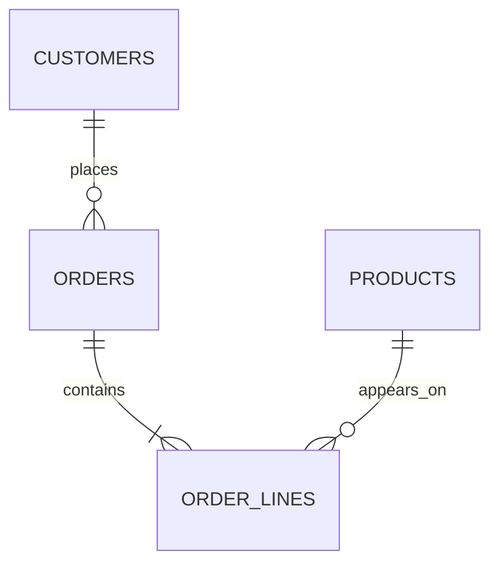

# Grain, Keys, and Normalization

**Learning goal:** Given a retail order, explain what one row represents, choose a key that identifies it, and decide which table should store each attribute.

## 1. Grain: What does one row represent?

Alice places order 101. She buys a laptop, two mice at the regular price, and another mouse on a promotional line.

| OrderID | LineNo | ProductID | Product | Quantity | Unit price paid | Line amount |
| --- | ---: | --- | --- | ---: | ---: | ---: |
| 101 | 1 | P1 | Laptop | 1 | €1,200 | €1,200 |
| 101 | 2 | P2 | Mouse | 2 | €25 | €50 |
| 101 | 3 | P2 | Mouse | 1 | €20 | €20 |

**Grain:** One row represents one line on an order.

| Grain | What one row tells you |
| --- | --- |
| One row per order | Order 101 totals €1,270. |
| One row per order line | Line 3 contains one mouse priced at €20. |

Both grains are useful. If you copy the €1,270 order total onto each of the three lines and sum it, you get **€3,810**. Sum the line amounts to calculate the order total, or read the total from a table with one row per order. In this example, the total is the sum of quantity × unit price paid, with no separate taxes or fees.

## 2. Keys: How do we identify each row?

`OrderID` repeats across Alice’s three lines, and `LineNo` can repeat across orders. Together, `(OrderID, LineNo)` identifies one line because line numbers are unique within each order. The pair `(OrderID, ProductID)` fails because `(101, P2)` occurs twice.

| Key | Meaning | Retail example |
| --- | --- | --- |
| Candidate key | A minimal set of columns that uniquely identifies a row | `(OrderID, LineNo)` |
| Superkey | Any set of columns that uniquely identifies a row, including sets with redundant columns | `(OrderID, LineNo, ProductID)` |
| Primary key | The candidate key chosen as the main identifier | `PRIMARY KEY (OrderID, LineNo)` |
| Composite key | A key made up of multiple columns | `(OrderID, LineNo)` |
| Foreign key | A reference to a primary key or another eligible unique key | `OrderLines.OrderID` references `Orders.OrderID` |
| Business key | An identifier used by the business or source system | `ProductID` in the store’s catalog |
| Surrogate key | An identifier created for the model without business meaning | A generated `OrderLineID` |

If the design uses a generated `OrderLineID` as the primary key, the grain stays **one row per order line**. Declare `OrderID` and `LineNo` as `NOT NULL` and enforce `UNIQUE (OrderID, LineNo)` to preserve the rule that each line number appears once per order.

## 3. Normalization: Which table stores each attribute?

Imagine a spreadsheet with the order date, customer details, and product name copied onto every line. If the product name changes in one row and stays the same in another, the sheet contains two names for the same product. Normalization uses business rules to find where such attributes belong.

A **functional dependency** `A → B` means that rows with the same value of `A` must have the same value of `B` under the business rules.

| Dependency | Business rule |
| --- | --- |
| `OrderID → OrderDate, CustomerID` | Each order has one date and one customer. |
| `CustomerID → CustomerName, CurrentCity` | Each customer has one name and current city in this model. |
| `ProductID → ProductName` | Each product has one name in the current catalog. |
| `(OrderID, LineNo) → ProductID, Quantity, UnitPricePaid` | Each order line has one product, quantity, and agreed unit price. |

| Normal form | What changes in this example? |
| --- | --- |
| **1NF** | Expand the product list into individual rows. Give each line its own product ID, quantity, and unit price columns. |
| **2NF** | Move order details to `Orders`. They depend on `OrderID` alone, a proper subset of the line’s composite candidate key. In general, 2NF checks for partial dependencies of non-key attributes on any candidate key. |
| **3NF** | Move the customer’s name and current city from `Orders` to `Customers`, and the product name from `OrderLines` to `Products`. The intermediate tables determine these attributes indirectly through `CustomerID` and `ProductID`. |

**Keep `UnitPricePaid` on `OrderLines`.** Alice paid €25 per mouse on one line and €20 on another. The price she paid depends on the order line. A current catalog price, if stored, belongs to the product in this simplified model.

### The resulting relational model

| Table | One row represents | Primary key | Foreign keys |
| --- | --- | --- | --- |
| `Customers` | One customer | `CustomerID` | — |
| `Orders` | One placed order | `OrderID` | `CustomerID` |
| `Products` | One catalog product | `ProductID` | — |
| `OrderLines` | One line on an order | `(OrderID, LineNo)` | `OrderID`, `ProductID` |

The diagram assumes a placed order has at least one line. A system that supports empty drafts would allow zero lines for a draft order.

## 4. From operational records to analytics

| Workload | Example question | Design concern |
| --- | --- | --- |
| **OLTP** (transaction processing) | What did Alice order, and what price did she pay? | Record orders consistently and enforce business rules. |
| **OLAP** (analytical processing) | How much did we sell by product category and customer city? | Define the grain and make it easy to group sales by the right attributes. |

The next lesson uses the retail example to show how facts capture business events and dimensions provide context.

## Check your understanding

1. Why does `(OrderID, ProductID)` fail as a key in this example?
2. If `OrderLineID` becomes the primary key, what happens to the grain?
3. If the mouse’s catalog price rises tomorrow, which price should you use to reconstruct Alice’s original order total?

Answers

1. The same product appears twice in order 101, so the pair is duplicated.
2. The grain stays one row per order line.
3. Use the agreed unit price stored on each original order line.

## References

- [Kimball Group · Declaring the Grain](https://www.kimballgroup.com/2003/03/declaring-the-grain/)
- [PostgreSQL · Constraints](https://www.postgresql.org/docs/current/ddl-constraints.html)
- [Aalto University · Normalization](https://opencs.aalto.fi/en/courses/databases/part-8/4-normalization)

[Back to the learning path](./README.md) · [Next: Fact and Dimension Tables](./fact_and_dimension_tables.md)
